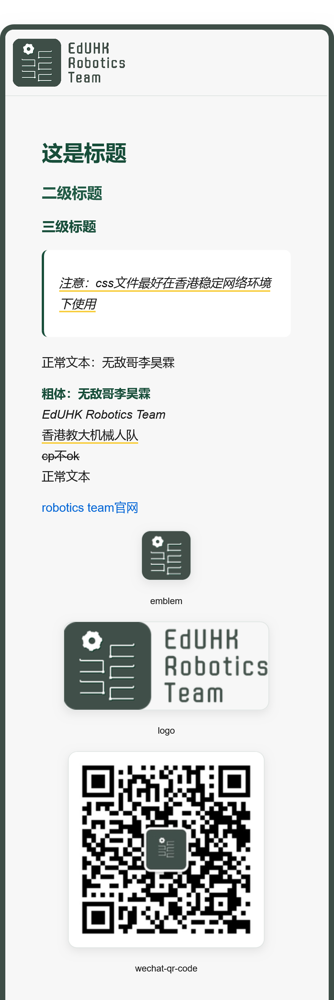

# MD2Card 推文模板

这是我们当前**微信（公众号）和小红书**推文的制作 pipeline：

```
Markdown 文案 ──┐
                ├──► md2card 渲染 ──► 推文卡片图
自定义 CSS ─────┘
```

使用 [md2card](https://md2card.cn) 将 Markdown 文案结合自定义 CSS 渲染成卡片样式的推文图，再发布到微信/小红书。

## 文件说明

| 文件 | 说明 |
| --- | --- |
| `robotics_md_template.css` | 当前使用的 md2card 样式：卡片整体、页首队徽 Logo、标题层级、正文、列表、引用、图片、分割线、CTA 按钮及小屏幕适配 |
| [`md-template.md`](./md-template.md) | Markdown 功能参考模板 |
| [`md-template-md2card-rendered.png`](./md-template-md2card-rendered.png) | 上述模板经 md2card 渲染后的效果图 |

## Markdown 示例

[`md-template.md`](./md-template.md) 展示了模板支持的常用写法，包括：

- 一级至三级标题
- 正文、粗体、斜体、高亮和删除线
- 引用、链接和图片

对应的 md2card 渲染效果如下，可在编写推文时对照参考：



## 使用流程

1. 撰写推文文案（Markdown）
2. 在 md2card 导入 `robotics_md_template.css`
3. 用该 CSS 渲染 Markdown，导出卡片图
4. 发布到微信/小红书

## 注意事项

- 模板中引用的图片（队徽、队标、公众号二维码）位于仓库 `logos/` 目录；使用 GitHub raw 链接时，大陆网络环境下加载可能缓慢或不稳定，建议在香港等稳定网络环境下操作。
- 发布前请确认公众号二维码仍是当前有效版本（`logos/team-wechat-qrcode-258.png`）。
